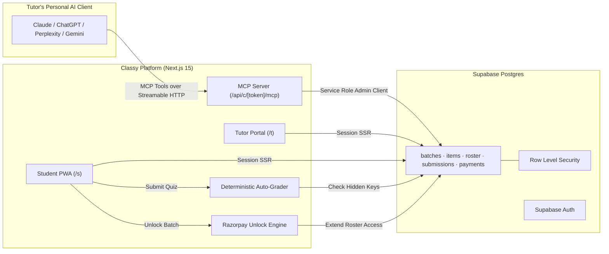

# Classy: Connect Your AI to Your Classroom

> **Prompt it. Push it. Track it.**  
> Tutors run their entire classroom directly from their favourite AI assistant (Claude, ChatGPT, Gemini, Perplexity) through the **Model Context Protocol (MCP)**. Classy receives, organizes, and securely delivers notes, quizzes, and assignments to students, evaluates attempts against answer keys, and handles batch subscriptions.

---

## Hard Architectural Principle: Zero AI Inside the App

**Classy contains NO AI SDKs, models, LLM wrappers, or AI dependencies.**
- Zero imports of `openai`, `@google/genai`, `@anthropic-ai/sdk`, `langchain`, or `ai`.
- We do not make LLM calls or run prompts on our servers.
- **You own your AI**: The tutor interacts with their AI client of choice. The AI client does the cognitive heavy lifting (lesson planning, quiz generation, LaTeX formatting, problem design) and invokes Classy's authenticated MCP tools over Streamable HTTP to create batches and publish coursework.
- Fixed answer keys for quizzes are evaluated deterministically in milliseconds without hallucination or LLM variance.

---

## Features

- **PWA & Offline Access**: Installable on iOS, Android, and Desktop with service worker precaching via `@serwist/next`. Opened study notes are cached offline for 30 days.
- **MCP Server Endpoints**: Exposes Streamable HTTP endpoints for any MCP-compliant AI client (`/api/c/[token]/mcp` and `/api/mcp`).
- **Deterministic Quiz Evaluation**: Secure answer keys stored server-side. Auto-evaluated upon student submission with score tracking and explanations.
- **Monetized Batches**: Tutors can set optional monthly fees in INR. Students unlock 30-day access via Razorpay (UPI, Cards, Netbanking) or instant simulated test mode. Platform has zero monthly subscription fees and zero software lock-in.
- **6-Character Join Codes**: Simple student onboarding via short codes (`SCI10A`), direct invite links (`/join/CODE`), WhatsApp sharing, and classroom QR codes.
- **Public & Free Revision Library**: Tutors can publish study materials to the public library, searchable and filtered by grade and subject.
- **Strict Role-Based Security**: Tutors and students have isolated portals (`/t` and `/s`) protected by Postgres Row Level Security (RLS) policies and `@supabase/ssr`.

---

## Demo & Test Accounts

Run the database seed script to initialize or reset demo accounts:
```bash
npm run seed
```

| Portal | Email | Password | Security Question & Answer |
| :--- | :--- | :--- | :--- |
| **Tutor Portal** | `tutor@classy.demo` | `Demo@1234` | **Q:** What was the name of your first school?<br>**A:** `demo` |
| **Student Portal** | `student@classy.demo` | `Demo@1234` | **Q:** What was the name of your first school?<br>**A:** `demo` |

- **Demo Batch**: `Class 10 Science (Batch A)`
- **Batch Join Code**: `SCI10A`
- **Premium Price**: ₹299 / month (includes 1 free notes item, 1 free public notes item, 1 premium quiz, 1 assignment, and 1 announcement).

---

## 🤖 Connecting Your AI via MCP

Classy exposes two transport endpoints using Streamable HTTP:

### 1. Token in URL (Recommended for Claude Desktop & Web)
No headers required. Ideal for clients requiring simple URL configuration:
```
https://your-domain.vercel.app/api/c/<YOUR_MCP_TOKEN>/mcp
```
*(For local testing: `http://localhost:3000/api/c/<YOUR_MCP_TOKEN>/mcp`)*

### 2. Bearer Authentication Header
For AI clients that configure headers:
- **Endpoint**: `https://your-domain.vercel.app/api/mcp`
- **Header**: `Authorization: Bearer <YOUR_MCP_TOKEN>`

### Connecting in Claude Desktop (`claude_desktop_config.json`)
```json
{
  "mcpServers": {
    "classy": {
      "command": "npx",
      "args": [
        "-y",
        "mcp-remote",
        "https://your-domain.vercel.app/api/c/<YOUR_MCP_TOKEN>/mcp"
      ]
    }
  }
}
```

### Inspecting Tools Locally
Test and debug the MCP server with the official MCP Inspector:
```bash
npm run mcp:inspect
```

### Supported MCP Tools
- `list_batches`: Lists all batches managed by the tutor.
- `create_batch`: Creates a new batch with a unique 6-character code.
- `create_notes`: Publishes lecture notes with Markdown and LaTeX math support.
- `create_quiz`: Creates auto-graded quizzes with questions, options, hidden correct keys, and explanations.
- `create_assignment`: Publishes assignments with submission deadlines and marks.
- `create_announcement`: Broadcasts announcements to students in the batch feed.
- `get_roster`: Returns the list of joined, pending, and invited students.
- `get_results`: Fetches student scores, attempts, and submission progress.

---

## 🏗️ System Architecture



---

## 🛠️ Tech Stack

- **Framework**: [Next.js 15](https://nextjs.org/) (App Router, React 19, Server Actions, TypeScript)
- **Styling**: Tailwind CSS v4, `shadcn/ui`, `lucide-react`, `motion`
- **Typography**: Fraunces (Display serif) & Plus Jakarta Sans (Body)
- **PWA & Offline**: `@serwist/next` with custom Service Worker caching strategies
- **Database & Auth**: [Supabase](https://supabase.com/) Postgres with Row Level Security (RLS)
- **Payments**: Razorpay Node SDK & Checkout with dynamic script loader and test mode
- **Math Rendering**: KaTeX with `remark-math` and `rehype-katex`

---

## 🚀 Local Development

1. **Clone and install dependencies**:
   ```bash
   git clone <repo-url>
   cd classy
   npm install
   ```

2. **Configure environment variables**:
   Copy `.env.example` to `.env.local` and add your Supabase credentials:
   ```bash
   cp .env.example .env.local
   ```

3. **Run database migrations**:
   Apply SQL files in `supabase/migrations/` to your Supabase project.

4. **Seed demo data**:
   ```bash
   npm run seed
   ```

5. **Start development server**:
   ```bash
   npm run dev
   ```
   Open [http://localhost:3000](http://localhost:3000).

6. **Build for production**:
   ```bash
   npm run build
   npm start
   ```

---

## 📄 License

MIT. Built with craft for tutors and students.
